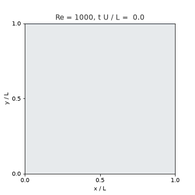
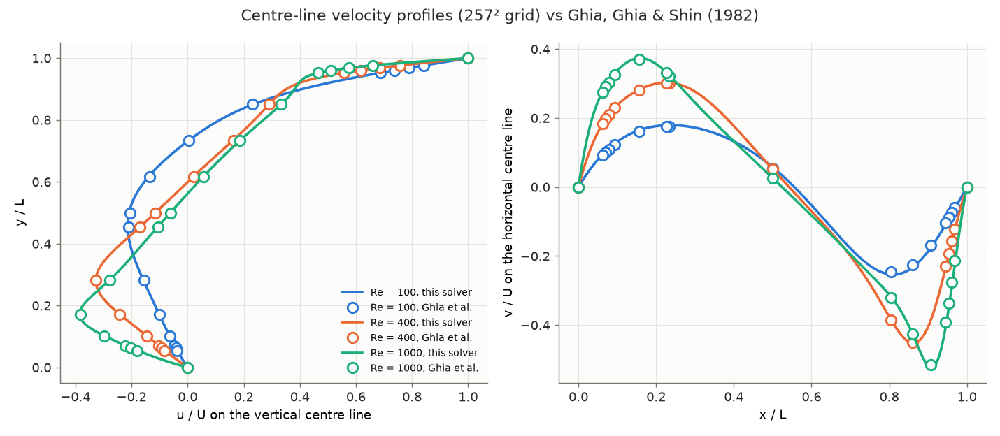
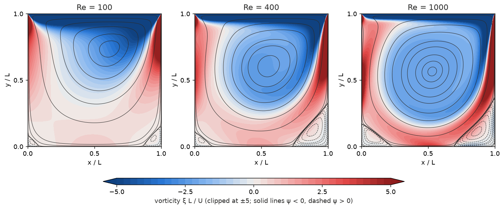
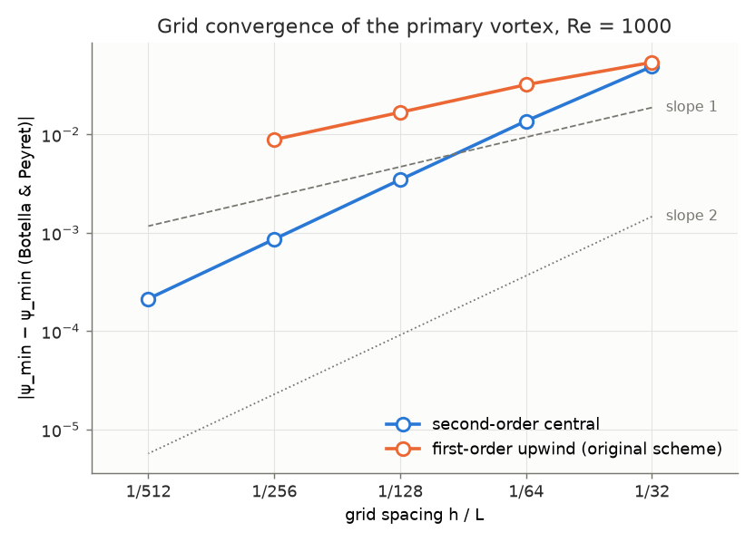
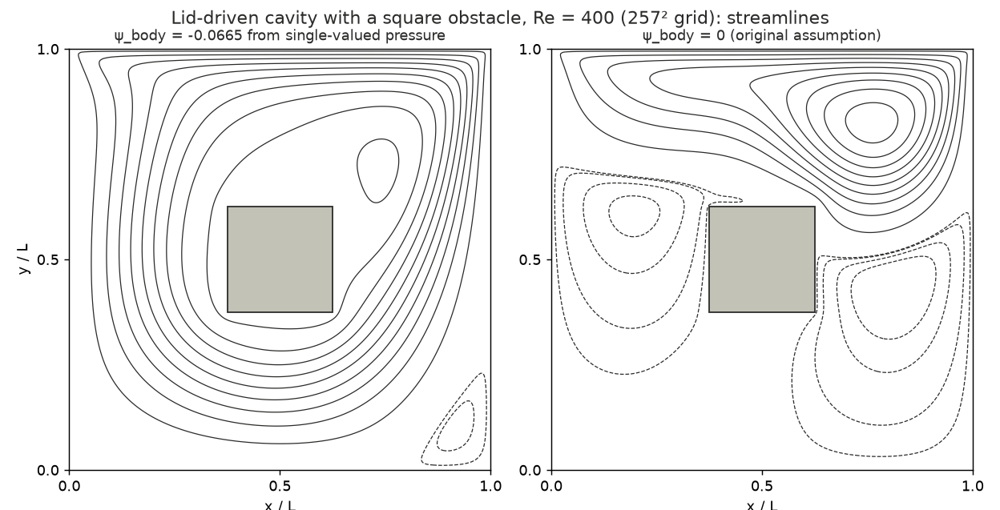

# Lid-driven cavity

[](https://github.com/Adh3r/lid-driven-cavity/actions/workflows/tests.yml)

**A validated finite-difference solver for the 2-D lid-driven cavity flow**, the
classic benchmark of incompressible CFD. It uses the stream function-vorticity
formulation with a direct Newton solver for steady states and Runge-Kutta time
marching for transients. Results are verified against the benchmarks of Ghia
et al. (1982) and Botella & Peyret (1998).



**Highlights**

- **Accurate.** The Richardson-extrapolated primary vortex at Re = 1000 matches
  the spectral reference of Botella & Peyret to 2 × 10⁻⁶; centre-line
  velocities match Ghia et al. to 0.003–0.014.
- **Verified order of accuracy.** A grid study (33² to 513²) measures 2.0 for
  the solver against 0.95 for the first-order scheme of the original course
  code.
- **Fast.** The steady equations are solved directly by Newton's method with
  an exact sparse Jacobian, using continuation in Re and grid sequencing.
  Re = 1000 takes about 6 s on a 129² grid, 15 s on 257² and 80 s on 513², end to end on a
  laptop.
- **Correct physics beyond the textbook case.** An obstacle inside the cavity
  gets its stream function from the single-valued pressure condition, which a
  naive ψ = 0 gets wrong.
- Python (NumPy, SciPy), 15 tests, ruff, CI. The derivation is in
  [`docs/theory.md`](docs/theory.md).

## Results

### Validation against the benchmarks (257² grid)

| Re | ψ_min (Ghia) | Vortex centre (Ghia) | \|ξ\| at the centre (Ghia) | Max error in u | Max error in v |
|---|---|---|---|---|---|
| 100 | −0.10348 (−0.10342) | (0.616, 0.737) (0.617, 0.734) | 3.167 (3.166) | 0.005 | 0.009 |
| 400 | −0.11369 (−0.11391) | (0.554, 0.606) (0.555, 0.606) | 2.292 (2.295) | 0.002 | 0.005 |
| 1000 | −0.11808 (−0.11793) | (0.531, 0.566) (0.531, 0.563) | 2.056 (2.050) | 0.003 | 0.014 |

At Re = 1000 the spectral solution of Botella & Peyret gives ψ_min = −0.1189366.
The Richardson extrapolation of the 257² and 513² solutions gives −0.1189388.





Three details of the comparison:
- **Ghia's own grid limits the agreement.** The largest v difference at
  Re = 1000 is at x = 0.9531, in the steep layer by the right wall. There the
  129² solution reproduces Ghia's value (−0.337), which was computed on a 129²
  grid. The 257² and 513² solutions and their extrapolation converge to −0.355.
- **A misprint.** One entry of Ghia's Table II (v at x = 0.9063, Re = 400)
  breaks the smooth profile and is treated as a misprint. Every other point is
  reproduced to 0.004.
- **Sign convention.** Ghia's vorticity has the opposite sign.

The last two are documented in [`benchmarks.py`](src/cavity/benchmarks.py).

### Grid convergence



The observed order of ψ_min is 2.0 for the second-order solver and 0.95 for
the first-order upwind scheme of the original code. On the same 101² grid, at
Re = 1000:

| | Original course code | This solver |
|---|---|---|
| Steady state | not reached in 100 time units | Newton, residual 10⁻¹² |
| ψ_min (Ghia: −0.1179) | −0.0979 (17 % weak) | −0.1133 |
| Max error in u | 0.212 | 0.024 |
| Re = 10 | diverges (fixed time step) | converges |

The first-order scheme behaves like an artificially viscous fluid
([`docs/revision.md`](docs/revision.md) explains why and lists every
correction).

### Extension: an obstacle inside the cavity



A body that does not touch the walls is a streamline, but its value of ψ is
unknown. Here it is fixed by requiring the pressure to be single-valued around
the body, which adds one equation to the Newton system. ψ_body then converges
at second order (Re = 400: −0.06666, extrapolated). The original project
assumed ψ_body = 0, the wall value. That leaves a pressure jump around the
body (as if a pump were inside it) and gives the flow on the right.

## How it works

| Step | Method |
|---|---|
| Formulation | Vorticity transport + Poisson equation for ψ; no pressure-velocity coupling |
| Space | Second-order central differences (first-order upwind available); Thom's formula for the wall vorticity |
| Steady solver | Newton's method on the discrete equations, exact sparse Jacobian, continuation in Re, grid sequencing |
| Transient solver | SSP Runge-Kutta 3 with an adaptive time step (CFL and diffusive limits); exact sparse LU Poisson solve |
| Diagnostics | Bicubic interpolation for centre-line profiles and sub-grid vortex centres |

## Quick start

```bash
python -m venv .venv
.venv\Scripts\activate                # Windows  (Linux/macOS: source .venv/bin/activate)
pip install -r requirements.txt
pip install -e . --no-deps

python -m cavity --re 1000 --n 129 --plot flow.png   # steady solution, compared with Ghia et al.
python -m cavity --re 400 --n 101 --transient        # time marching from rest
python -m pytest -q                                  # 15 verification and validation tests
```

The figures and tables in this README are reproduced by the scripts in
`studies/`: `validation.py`, `grid_convergence.py --fine`,
`original_method.py`, `obstacle.py` and `animation.py`. They write to
`docs/figures/` and `docs/results/`.

```python
from cavity import continuation, summary

result = continuation([1000], n=257)[1000.0]
print(summary(result))  # psi_min, vortex centres, errors against Ghia et al.
```

## Repository layout

```
src/cavity/       solver package (steady Newton, transient RK3, obstacle, diagnostics, plots, CLI)
studies/          scripts that reproduce every figure and table
test/             pytest suite
docs/             theory, revision notes, figures, result tables
original/         the original course submission, unmodified
```

## Origin

The project started as a team assignment for *Mecànica de Fluids* at EETAC – UPC
(January 2026), by Adam Ruiz Herrero, Dènia Cabrera and Elena Alegre. It was
rewritten and validated in November 2026. The original code is kept in
`original/`, and [`docs/revision.md`](docs/revision.md) records what changed.
See [`CREDITS.md`](CREDITS.md).

## Licence

MIT. See [`LICENSE`](LICENSE).
